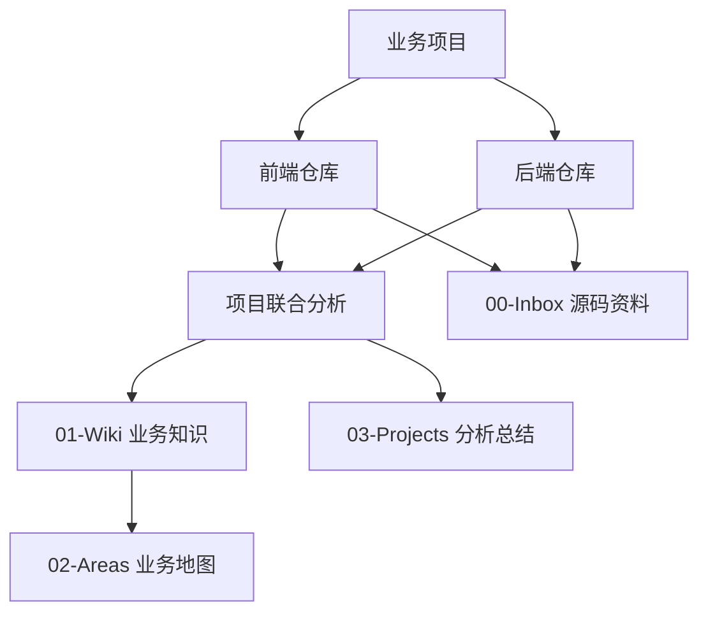

# 业务项目与前后端仓库

一个业务项目可由多个独立 Git 仓库组成。新增入口填写项目名称、前端仓库、后端仓库；各端连接配置和分支独立保存。前后端分别至少一个，导入只索引代码，不发送模型请求。

项目管理可加入同一业务的其他前端或后端仓库。仓库只归属当前知识库的一个项目；编辑采用项目 revision 检查，避免覆盖其他窗口的修改。Git 地址、分支、提交、认证凭据仍属于各仓库，项目分组不改变 Git 历史。

## 决策与边界

- 项目是业务分析、问答和生成文档的范围；仓库是代码连接、同步和证据的范围。仅按目录分组无法提供跨端分析，因此增加显式项目记录。
- 项目记录保存在本地 SQLite 配置，Markdown 仍是知识正文的权威来源。项目按知识库隔离，不从相似仓库名称自动推断成员。
- 原始资料路径继续保留仓库 ID。项目输出使用独立的 `项目/<project_id>` 命名空间，frontmatter 记录 `project_id` 和各仓 `source_repositories` 提交快照。
- 联合分析在统一上下文预算内按仓库轮转取样。总结逐仓列出覆盖范围；接入前后端不等于已经读取全部业务代码。
- 所有参与仓库必须明确绑定同一个获准的模型目标。项目绑定操作明确授权项目各仓库；分组本身不复制绑定、不调用模型、不启用自动 AI。项目分析由用户主动发起。
- 源码工具需指定项目成员仓库，证据保留真实 `source://<repository_id>/<commit>/<path>#Lx-Ly`。同名文件不会混用来源；未读取的代码不能成为已核实引用。
- 跨端流程只能以两端实际源码证据建立；未知接口匹配、数据含义和运行行为列为待确认。
- 任何成员提交、项目成员/revision、模型目标或知识库变化，都会拒绝继续使用旧分析或问答上下文。人工修改保留为原文，模型更新进入候选。

项目与仓库同时存在增加了一层管理，但避免把单仓目录误当完整业务。保留旧单仓 API 用于未分组仓库；归入项目后拒绝生成独立仓库地图，项目同步也不会隐式触发付费分析。

## 内容清理

已存在的单仓分析不能换个项目标题就视作联合分析。清理应先备份 vault、SQLite 和受管 revision，再创建明确成员关系，生成项目级文档；只有 revision 与受管状态一致的旧生成内容才可移出活动知识库。人工编辑与冲突内容应保留。源码索引、仓库、凭据引用和历史聊天继续保存。
